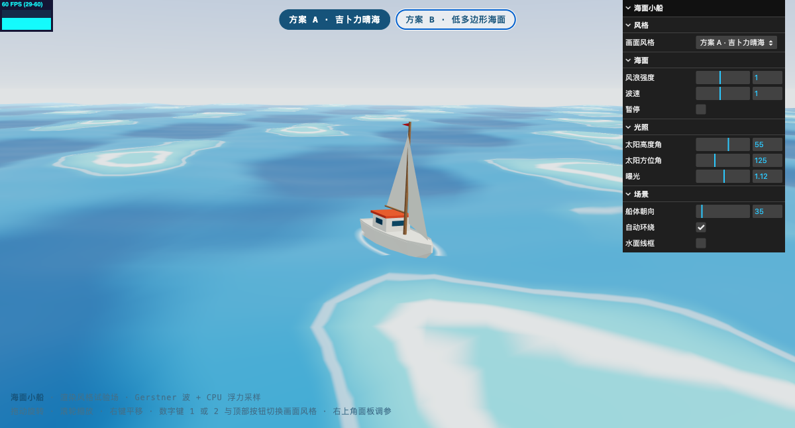
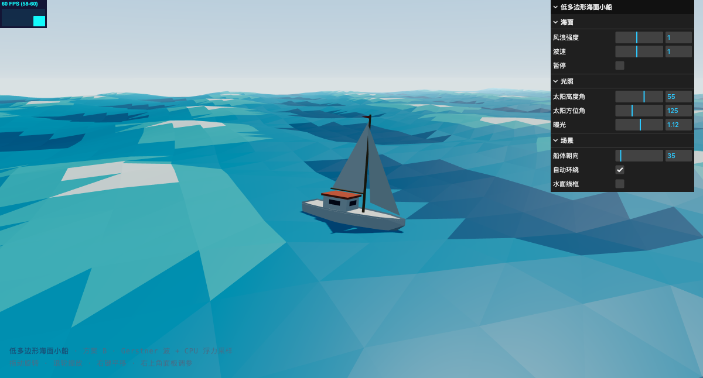
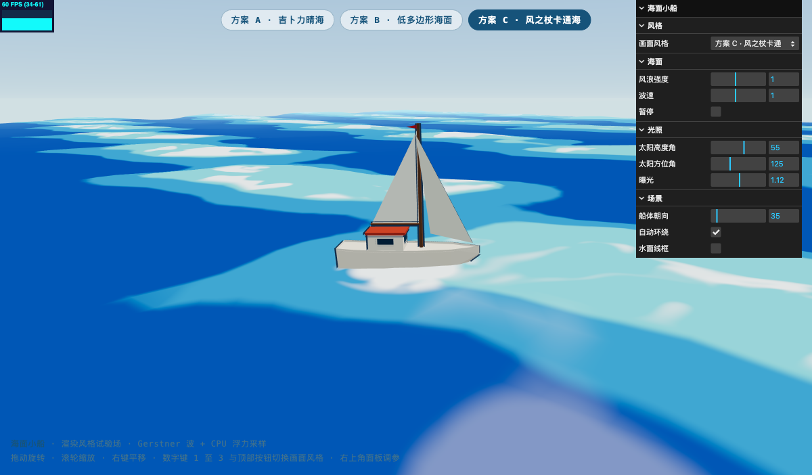
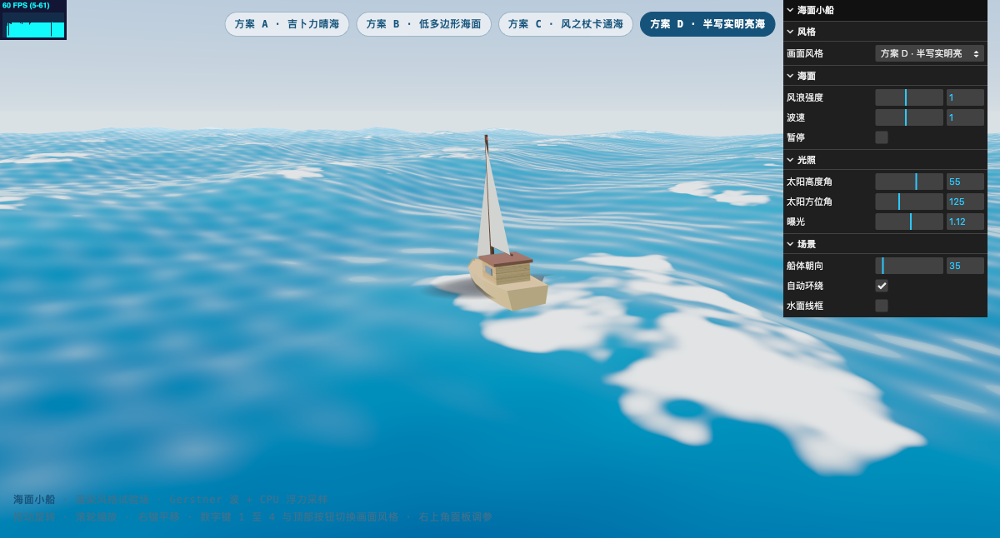
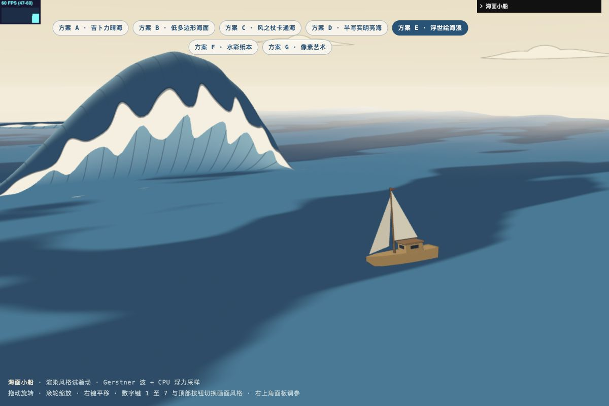

# 海面小船渲染风格试验场

基于 Three.js 的海面小船 CG 场景，作为不同渲染风格的试验场。画面定位：晴朗白天，清澈蓝色水体，光照充足，风格允许偏向动画风。风格调研分两期：第一期四种候选方案见 [docs/设计候选方案.md](docs/设计候选方案.md) 且已全部实现；第二期扩展调研另筛出八个新方向，见 [docs/风格扩展调研.md](docs/风格扩展调研.md)。

## 画面风格切换

页面顶部提供切换按钮，数字键 1 至 4 亦可切换，右上角控制面板同步显示当前风格。切换时水面实现、船体材质、天空与雾色、光照强度、云体材质、波形振幅与环境贴图整体联动。

### 方案 A 吉卜力晴海（默认）



平滑渐变的蓝青色海面，波峰以等高线式细白描边勾出浪花，大块积云，明亮暖调的天光。水面为 GPU 顶点位移加自定义片元着色，波形平缓，船体换用卡通渐变着色，水线处以泡沫环贴图压住船身。

### 方案 B 低多边形海面



全场景由几何体块构成：折面波浪配逐面平涂配色，程序化拼装的平顶着色帆船，真实阴影投影在海面。

### 方案 C 风之杖卡通海



宝蓝色海面配硬边三档色带，浪峰由域扭曲噪声生成流动消散的旋涡白沫，船周环绕断续浪花。船体为卡通渐变着色加法线外扩的倒置外壳描边，波形中等起伏，天空饱和度最高。

### 方案 D 半写实明亮海



皮克斯式明亮渲染：深蓝水体配完整的程序化水面光学，波峰白色泡沫贴图自然，木纹质感船体带水线湿润渐变与柔和船影。波形振幅与方案 B 相当。

### 方案 E 浮世绘海浪



动态木版画：三档靛蓝按波高和坡向分区，一道主卷浪配两道远处次浪，纸白浪唇与细流线共同刻画翻卷。小白沫随主浪相位推进，整片贴合水面；米黄天空留白，船体使用固定两档颜料和细描边。进入 E 自动采用构图机位与侧面船向、关闭环绕并收起面板，退出恢复之前的视图。支持通过 `?style=E&time=0&paused=1` 重现静态画面。详见 [docs/浮世绘海浪深化方案.md](docs/浮世绘海浪深化方案.md)。

## 运行

整个页面是纯静态文件，Three.js 通过 importmap 从 CDN 加载，需要联网。推荐通过启动脚本运行本地服务器：服务器发送禁缓存响应头，开发期模块改动后浏览器不会拿到旧代码。

```bash
./scripts/start.sh          # Linux / macOS
```

```powershell
./scripts/start.ps1         # Windows PowerShell
```

脚本会先检测并清理端口 38517 上的旧进程，再以 [scripts/serve.py](scripts/serve.py) 启动静态服务器（等价于 `python3 scripts/serve.py 38517`）。随后访问 `http://127.0.0.1:38517`。

若曾用旧的 `python3 -m http.server` 方式访问过，首次换用新服务器时请对页面做一次强制刷新（Cmd+Shift+R 或 Ctrl+F5），清掉浏览器里已缓存的旧模块。

## 操作

- 左键拖动旋转视角，滚轮缩放，右键平移
- 顶部按钮或数字键 1 至 7 切换画面风格
- 右上角面板实时调整风格、海面、光照与场景参数

参数说明：

| 分组 | 参数 | 作用 |
| --- | --- | --- |
| 风格 | 画面风格 | 与页面顶部按钮联动 |
| 海面 | 风浪强度 | 统一缩放全部波的振幅与波陡，各风格共用 |
| 海面 | 波速 | 波形演化速度倍率 |
| 海面 | 暂停 | 冻结波面时钟 |
| 光照 | 太阳高度角 / 方位角 | 同步驱动平行光方向、天穹太阳与水面高光 |
| 光照 | 曝光 | ACES 色调映射曝光量 |
| 场景 | 像素尺寸 | 方案 G 的像素块大小 |
| 场景 | 船体朝向 | 船的航向，浮力采样随之改变 |
| 场景 | 自动环绕 / 水面线框 | 相机与调试选项 |

## 实现要点

### 波形与浮力同源

海面由五组 Gerstner 波叠加驱动，方向、波长、波陡各异，全部波陡之和小于 1 以防波峰打环。深水波相速取 c 等于 sqrt(g/k)，波长越长的波传播越快。渲染端按波函数位移水面顶点，浮力端在船底前后左右四个采样点用同一波函数求波高，推出升沉、纵摇与横摇目标值后做指数平滑，保证船体与水面严格贴合并带惯性感。波形定义集中在 [src/waves.js](src/waves.js)，波场还带一个风格级振幅比例，吉卜力风格下波形更平缓。

### 方案 A：GPU 位移加自定义片元着色

水面网格为 200 乘 200 划分的平面，顶点着色器在 GPU 上完成 Gerstner 位移并用解析式求法线。片元着色器按波高做三段色渐变，波峰处以两道等高线式细白描边勾出浪花，掠射角叠加微弱天空反射与柔和太阳亮斑，末尾接入与内置材质相同的色调映射、输出编码与雾。波形参数以 uniform 数组传入，与 CPU 端浮力采样严格一致。方案 A 的水面不接收阴影，改以一圈水线泡沫环贴图压住船身。实现在 [src/water_ghibli.js](src/water_ghibli.js)。

### 方案 B：CPU 位移加折面平涂

水面网格为 96 乘 96 划分的平面，三角形边长约 2.9 米。每帧先在索引几何体上对每个独立顶点求一次 Gerstner 位移，再散射到非索引几何体，按面重心高度把每个三角形分入波谷深水、主体海蓝、波峰浅青、浪花白四档顶点色，配合 flatShading 的微分求导法线得到折面平涂效果。实现在 [src/water.js](src/water.js)。

### 方案 C：硬边色带加旋涡浪花

顶点位移与方案 A 共用同一套 Gerstner 着色器代码，抽在 [src/water_common.js](src/water_common.js) 中。片元着色器按波高分三档色带，边界以极窄过渡做抗锯齿，背光坡面整体压暗形成两档受光。浪花为域扭曲三阶值噪声生成的旋涡图案，由波高阈值触发，随时间缓慢流动消散；船周以距离场叠加同源噪声得到贴边实心环与外侧断续旋涡环。实现在 [src/water_toon.js](src/water_toon.js)。

### 方案 D：程序化水面光学

水体吸收由视线角度主导、波高为次要项，俯视深处浓郁、掠射处转淡；施密特菲涅耳加权的程序化天空反射随仰角快速转入天穹蓝；三组交叉行波扰动微法线驱动太阳高光闪烁；逆光方向的薄波峰以伪次表面散射透出青绿亮色；泡沫由两张不同流向的噪声混合，分波峰触发与浪峰过后拖尾双通道。实现在 [src/water_realistic.js](src/water_realistic.js)。

### 方案 E：三档颜料与连续卷浪

共享 Gerstner 位移及 CPU 浮力采样。水面片元重新解析波高与法线，按三档靛蓝和局部坡向分区，消除粗网格插值造成的色块折线；墨线只出现在浪坡和浪唇，使用 `fwidth` 抗锯齿。水面、卷浪、贴花、船与天空均不使用 ACES 色调映射，统一在线性空间绘制并输出 sRGB；水面与卷浪共用颜料函数。纸纹稳定在屏幕上，不随噪声漂移。方案 E 的波面时钟以 0.32 倍速推进，船体和浪花共享该时钟。

小白沫使用少量可复现的分组贴片，沿主浪相位移动，整张 XZ 细分网格逐点采样水平与垂直位移。两轴尺寸同时变化，透明度负责淡入淡出，不朝相机倾斜，也不放大远处白沫。实现在 [src/water_ukiyoe.js](src/water_ukiyoe.js) 与 [src/foam_decals.js](src/foam_decals.js)。

### 连续主卷浪

一道主浪与两道次浪采用单调横向坐标的参数曲面，长背坡接卷曲剖面，包络只影响高度和浪唇；每个根部顶点采样同一波面并使用水平位移，整段接入海面。浪唇指尖长短交错，以纸白和导数抗锯齿墨线刻画；直接用片元颜料分区替代无效的顶点色明暗烘焙与开口曲面倒置外壳描边。浪体随主波相位推进，回绕前收回水面，不再随相机随机传送。实现在 [src/wave_claws.js](src/wave_claws.js)。

### 方案 F：水彩纸本后处理

首个走后处理管线的风格。底景以柔和的水洗色调渲染（吉卜力水面骨架换配色、卡通船体、纸味天空与柔和光照），再经 EffectComposer 后处理链做水彩化：自定义 pass 依次施加手绘抖动、湿画法柔化、颜料沉积边缘加深、亮度分区量化（量化边界用纸纹扰动生成有机色块）、颜料沉降颗粒、高光留白与纸底罩染，最后经 OutputPass 做色调映射与编码。水彩 pass 实现在 [src/watercolor_pass.js](src/watercolor_pass.js)。

### 方案 G：像素艺术

复用明亮底景，经官方 RenderPixelatedPass 像素化：整幅画面按可调像素尺寸分块，按法线与深度差异叠加单像素描边；波面时钟按每秒十二帧量化，波浪与船体一起步进，强化复古机感。像素尺寸可在场景分组实时调整。方案 G 与 F 共用同一条后处理链，按风格切换各 pass 的启停。

### 风格化船模与云

船体不依赖外部模型文件，由六个分站轮廓放样而成，船首船尾扇形封口，按水线高度自动分成上下两色。每个部件保留五套材质：方案 B 用平顶 PBR，方案 A、C 用三档渐变映射的卡通着色并各配色板，方案 E 用不依赖实时光照的两档颜料，方案 D 用平滑 PBR 加程序化木纹贴图，水线附近经顶点色渐变压暗模拟湿润。方案 C 与 E 在实体部件外侧叠加法线外扩的倒置外壳描边，方案 D 以椭圆软阴影贴图近似船影。天穹材质经 PMREM 生成环境贴图，供方案 B 与 D 的 PBR 船体做环境光照，切换风格时随天穹配色重建。积云按风格在平顶、卡通与平滑三套材质间切换，方案 E 下隐藏立体积云并启用云纹精灵。实现在 [src/boat.js](src/boat.js) 与 [src/environment.js](src/environment.js)。

### 天空与光照

天穹为 BackSide 球体上的渐变着色器，叠加太阳圆盘与两层光晕，末尾接入 three.js 的色调映射与输出编码，与水面经过同一套 ACES 管线，地平线处与场景雾色无缝衔接。各风格的全部场景级参数集中在 [src/styles.js](src/styles.js) 的配置表中，切换风格时一次性应用。

### 水平线融合

雾色与天穹地平线色取同一数值，水面边缘在雾中完全淡出，因此无需无限延伸的网格即可获得自然的海天交界。

## 目录结构

```
sea_boat/
├── index.html            页面入口、importmap 与风格切换按钮
├── src/
│   ├── main.js           渲染器、相机、风格切换、控制面板与主循环
│   ├── styles.js         各风格场景级配置与卡通渐变映射
│   ├── waves.js          Gerstner 波场定义与采样
│   ├── water_common.js   两套着色器水面共用的波形代码与 uniform
│   ├── water.js          方案 B 水面：CPU 位移与逐面分档配色
│   ├── water_ghibli.js   方案 A 水面：GPU 位移与渐变着色
│   ├── water_toon.js     方案 C 水面：硬边色带与旋涡浪花
│   ├── water_realistic.js 方案 D 水面：程序化水面光学
│   ├── water_ukiyoe.js   方案 E 水面：靛蓝色阶与爪状浪花
│   ├── foam_decals.js    方案 E 爪形浪花贴花系统
│   ├── wave_claws.js     方案 E 立体爪浪网格
│   ├── watercolor_pass.js 方案 F 水彩纸本后处理
│   ├── boat.js           程序化船模、六套材质、描边与浮力驱动
│   └── environment.js    天穹、光照、积云、云纹精灵、环境贴图与风格应用
├── scripts/
│   ├── start.sh          本地服务器启动脚本（bash）
│   └── start.ps1         本地服务器启动脚本（PowerShell，UTF-8 BOM）
└── docs/
    ├── 设计候选方案.md     第一期风格调研与四种候选方案
    ├── 风格扩展调研.md     第二期风格扩展调研（方案 E 至 L）
    ├── screenshot-ghibli.png
    ├── screenshot-lowpoly.png
    ├── screenshot-toon.png
    ├── screenshot-realistic.png
    ├── screenshot-ukiyoe.png
    ├── screenshot-watercolor.png
    └── screenshot-pixel.png
```

## 环境要求

- 支持 WebGL2 的浏览器，Chrome、Edge、Firefox、Safari 近年版本均可
- 桌面端 60 帧/秒，页面左上角显示帧率

## 后续风格规划

| 方案 | 状态 |
| --- | --- |
| A 吉卜力式晴海 | 已实现 |
| B 低多边形几何海 | 已实现 |
| C 风之杖式卡通海 | 已实现 |
| D 半写实明亮海 | 已实现 |
| E 浮世绘海浪 | 已实现 |
| F 水彩纸本 | 已实现 |
| G 像素艺术 | 已实现 |
| H 至 L 共五个新候选 | 已调研，见 [docs/风格扩展调研.md](docs/风格扩展调研.md)，建议推进顺序为黏土 |
